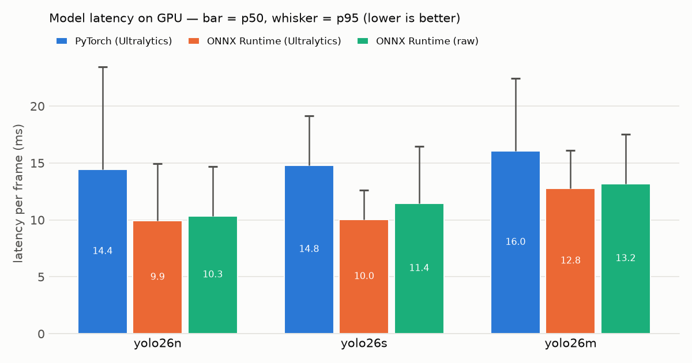
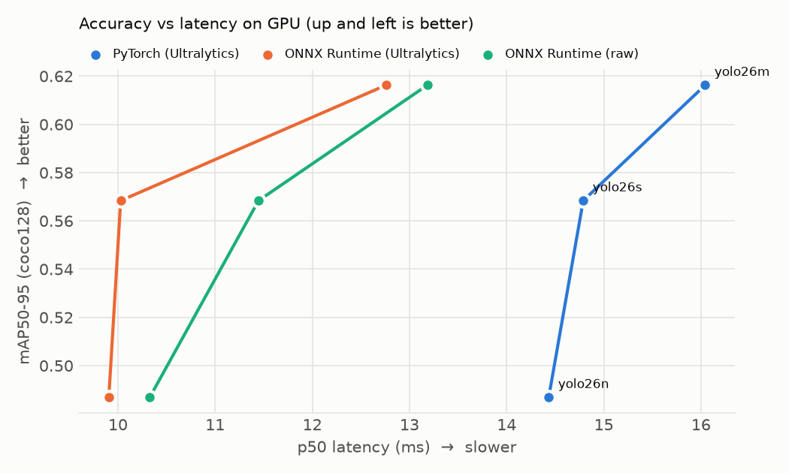

# Real-Time Object Detection, Tracking & Counting

YOLO26 pipeline for webcam, video and images: detection, persistent tracking IDs (ByteTrack),
line-crossing and zone counting with dwell time, CSV/JSON export, and a reproducible
**PyTorch vs ONNX Runtime benchmark** across model sizes on GPU and CPU.


**Headline result:** on an RTX 4050 Laptop GPU, **YOLO26m on ONNX Runtime runs at 12.8 ms per
frame with mAP 0.616**, faster than **YOLO26n on PyTorch (14.4 ms, mAP 0.487)**.
A 26% more accurate model at lower latency, from changing only the inference engine.

---

## Features

| | |
|---|---|
| **Inputs** | webcam, video file, single image, folder of images |
| **Detection** | Ultralytics YOLO26 (n/s/m/l/x), `.pt` or exported `.onnx` |
| **Backends** | PyTorch, ONNX Runtime via Ultralytics, and a raw ONNX Runtime path (~150 lines, own pre/post-processing) |
| **Tracking** | ByteTrack / BoT-SORT, plus a minimal IoU tracker written from scratch for reference |
| **Counting** | directional line crossing (in/out, debounced), polygon zones (occupancy, unique entries, dwell time) |
| **Overlay** | boxes, track IDs, motion trails, live FPS + pre/inference/post latency HUD |
| **Export** | per-frame detections CSV, events CSV, JSON run summary |
| **Benchmark** | model sizes × backends × devices, p50/p95, repeat spread, parity check, mAP |
| **Tests** | 73 pytest tests (geometry, counting, tracking, export, ONNX pre/post-processing, benchmark stats) |

---

## Benchmark results

RTX 4050 Laptop GPU (6 GB) · Windows · Python 3.13 · PyTorch 2.11 (CUDA 12.8) ·
ONNX Runtime GPU 1.26 · Ultralytics 8.4 · input 384×640 (16:9 letterbox) · 5 repeats × 300 frames (GPU),
100 frames (CPU) · full environment in [`results/environment.json`](results/environment.json).

### GPU

| Model | mAP50-95* | PyTorch p50 / p95 | ONNX Runtime (Ultralytics) p50 / p95 | Speed-up |
|---|--:|--:|--:|--:|
| yolo26n | 0.487 | 14.4 / 23.5 ms | **9.9 / 14.9 ms** | 1.45× |
| yolo26s | 0.568 | 14.8 / 19.2 ms | **10.0 / 12.6 ms** | 1.48× |
| yolo26m | 0.616 | 16.0 / 22.4 ms | **12.8 / 16.1 ms** | 1.25× |

### CPU (same laptop, no GPU)

| Model | PyTorch p50 | ONNX Runtime (raw) p50 / p95 | Speed-up |
|---|--:|--:|--:|
| yolo26n | 42.3 ms | **20.4 / 23.9 ms** | 2.1× |
| yolo26s | 86.4 ms | **52.0 / 55.3 ms** | 1.7× |
| yolo26m | 225.9 ms | **142.8 / 148.4 ms** | 1.6× |

<sub>*mAP on coco128: 128 images from COCO train2017, so absolute values are optimistic;
use for relative comparison between sizes. Parity F1 between PyTorch and ONNX boxes = 1.000 for every
configuration: the exported models give identical detections.</sub>

Full table (all three backends, pre/inference/post split): [`results/benchmark.md`](results/benchmark.md)

<p align="center">
  
  
</p>

### What the numbers say

1. **PyTorch on this GPU is launch-bound, not compute-bound.** n, s and m all cost ~14–16 ms
   although m has 8.5× the parameters of n. During inference the GPU sits mostly idle while Python
   and the PyTorch dispatcher work through ~125 layers per frame, each launching small kernels (diagnosed with
   [`scripts/diag_latency.py`](scripts/diag_latency.py): latency tracks layer count, not parameter count;
   FP16 gives no speed-up).
2. **ONNX Runtime removes most of that overhead**: one C++ call runs the whole optimised graph
   (operator fusion, constant folding). Result: 1.25–1.5× faster on GPU, with lower p95 jitter.
3. **So the right model choice changes with the engine.** Under PyTorch the larger model is
   "free", under ONNX Runtime it costs a few ms; in both cases **yolo26m is the best GPU choice**.
4. **On CPU, ONNX Runtime is 1.6–2.1× faster.** For a CPU-only robot, yolo26n + ONNX Runtime
   (~48 FPS) is the only comfortably real-time option; yolo26s (~19 FPS) is borderline.

### Caveats

- The GPU is still partly overhead-bound under ONNX Runtime (n ≈ s). TensorRT or CUDA Graphs would
  be the next step; not in scope here.
- The raw ONNX Runtime backend is not faster than Ultralytics' ORT path on GPU (its NumPy
  preprocessing costs ~1.5 ms vs 0.8 ms). On CPU it has the tightest p95 of all backends.
- Laptop GPU results depend on power state. Run plugged in, *Best performance* mode, nothing else
  running; the `spread` column in `benchmark.csv` flags noisy runs.

### Methodology

Frames are decoded into RAM before timing · every backend receives the same 384×640 tensor (ONNX
exported at exactly the rectangle PyTorch letterboxes 16:9 frames to) · 30 warm-up frames discarded ·
5 repeats, median of per-repeat p50/p95 · wall-clock time around the whole `detect()` call ·
detections compared box-by-box against PyTorch (parity) · mAP measured on the `.pt` weights.

---

## Quick start (Windows, PowerShell)

```powershell
py -3 -m venv .venv               # Python 3.11+
.\.venv\Scripts\Activate.ps1
pip install -e ".[dev,onnx]"
python scripts\check_env.py       # Python, OpenCV, CUDA, ONNX Runtime, webcam
python scripts\get_samples.py     # sample images

rtod detect --source data\samples\bus.jpg
rtod detect --source 0            # webcam
```

**GPU ONNX Runtime** must match PyTorch's CUDA major version. With PyTorch built for CUDA 12.x:

```powershell
pip uninstall -y onnxruntime onnxruntime-gpu
pip install "onnxruntime-gpu>=1.21,<1.27"   # 1.27+ on PyPI is built for CUDA 13
```

## Usage

```powershell
# Tracking + counting. Coordinates are normalised 0..1; click them with:
python scripts\pick_points.py --source data\videos\clip.mp4

rtod track --source data\videos\clip.mp4 --model yolo26m.pt --classes 0 `
  --line "door:0.5,0.95,0.5,0.05" --zone "desk:0.6,0.3;0.95,0.3;0.95,0.95;0.6,0.95"

# Same with the exported ONNX model
rtod track --source 0 --model models\yolo26m_384x640.onnx --classes 0 --line "door:0.5,0.95,0.5,0.05"

# Raw ONNX Runtime backend (own pre/post-processing)
rtod detect --source 0 --backend ort --model models\yolo26m_384x640.onnx

# Benchmark (exports ONNX models into models\ automatically)
rtod bench --source data\videos\clip.mp4 --models n,s,m --map --repeats 5

# README GIF from a run
python scripts\make_gif.py runs\track\webcam0_yolo26m_384x640.mp4 --start 1 --seconds 8
```

**Line direction:** `in` = crossing toward the side the yellow arrow points to (right-hand side of
p1→p2 on screen). Swap the two points to flip it.

**Outputs** (`runs/track/`): annotated `.mp4`, `*_detections.csv` (frame, time, track ID, class,
confidence, box), `*_events.csv` (line in/out, zone enter/exit with dwell seconds), `*_summary.json`
(totals per line/zone and class, latency statistics, run configuration).

Window keys: `q`/`Esc` quit · `space` pause · `s` snapshot.

---

## How it works

```
FrameSource ──▶ Detector ──────────────▶ Tracker ──▶ Line / Zone counters ──▶ Exporter (CSV/JSON)
webcam/video    PyTorch | ORT (Ultra.)   ByteTrack     cross-product side test       │
image/folder    | ORT (raw)              | IoU (ours)  + segment intersection        ▼
                └── Detection(xyxy, conf, class, track_id) ──▶ Overlay (boxes, trails, HUD)
```

Every stage speaks one type, `Detection`, so backends are interchangeable; that is what makes the
benchmark a like-for-like comparison.

```
src/rtod/
  types.py         Detection + Timing dataclasses
  geometry.py      IoU, IoU matrix, NMS, side-of-line, segment intersection, point-in-polygon
  detector.py      Ultralytics backend (.pt / .onnx) + ByteTrack/BoT-SORT
  onnx_backend.py  raw ONNX Runtime: letterbox, NCHW tensor, decode (end-to-end + classic with NMS)
  tracking.py      IouTracker: greedy IoU association + lost-track timeout
  counting.py      LineCounter (direction, debounce), ZoneCounter (occupancy, dwell)
  export.py        streaming CSV + JSON summary
  bench.py         benchmark harness: repeats, percentiles, parity, mAP, table, plots
  sources.py       webcam / video / image / folder -> frames
  overlay.py       boxes, labels, trails, lines, zones, HUD
  metrics.py       EMA FPS, latency percentiles
  cli.py           rtod detect | track | bench
scripts/           check_env, get_samples, record_clip, pick_points, diag_latency, make_gif
tests/             73 tests (pytest)
```

## Tests

```powershell
pytest
```

The tests need no GPU or model download: ONNX pre/post-processing is tested with an injected fake
session, and counting/tracking with synthetic tracks.

## License

Code: MIT © 2026 Dorin Dascălu.
Ultralytics YOLO and its pretrained weights are licensed under **AGPL-3.0**. Commercial products
built on them need either AGPL compliance or an Ultralytics Enterprise license.
